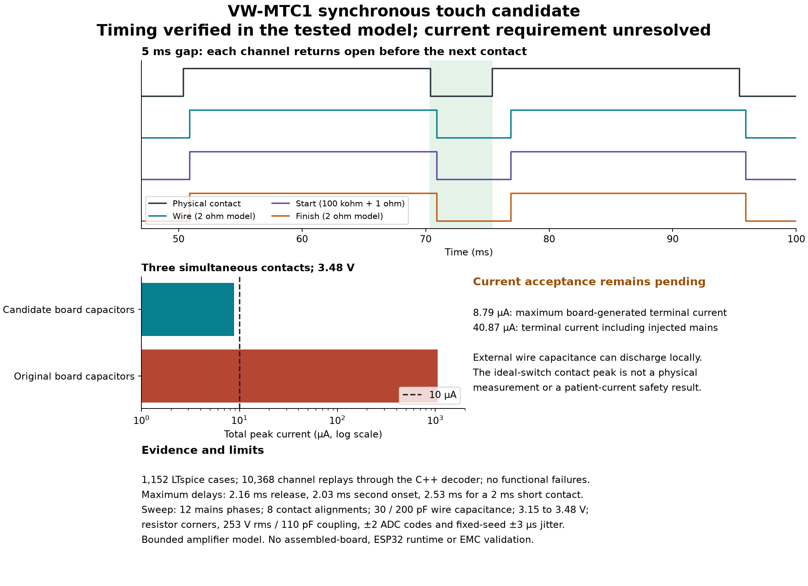

# VW-MTC1 touch redesign candidate, Rev00

**Status: timing verified in the tested model; current requirement unresolved.**
This is a design investigation, not a released hardware revision. KiCad and the
pin-map header still describe Rev A. The draft PR must remain unmerged until the
current measurement boundary is agreed and the remaining hardware work is complete.

The requested limit is **10 µA total across all three inputs, including transients**.
The candidate meets that limit for current generated by the PCB and measured at
its terminals, including discharge of populated board capacitors. It does not
establish that limit at the physical contact when external wire capacitance is
included. That capacitance can store board-supplied energy and discharge locally,
bypassing resistors on the PCB. This is the outstanding design decision.



## Candidate circuit

Replace the slow pull-up/27 nF/Schmitt path with a synchronous resistance
measurement. A 1 kHz excitation drives each sense node through 100 kΩ. Two
200 kΩ resistors bias that node from +3V3 and GND. A 1.2 MΩ resistor is the only
connection between that protected node and the corresponding maze input.
All populated board capacitors and protection components must be on the
protected side of that resistor.

An MCP6004 quad follower buffers the three sense nodes and one unloaded reference
bridge. An additional MCP3204-B reads all four channels. The reference has the same
100 kΩ/200 kΩ/200 kΩ network and board capacitance, without a maze connection.
This reference removes common changes in supply and excitation amplitude.

| Item | Rev A | Candidate, not yet applied to KiCad |
| --- | --- | --- |
| R51, R53, R55 | 10 kΩ series | 1.2 MΩ, 1%, current limiting |
| R52, R54, R56 | 360 kΩ pull-up | 100 kΩ, 0.1%, connected to excitation |
| Per-channel bias | Pull-up only | 200 kΩ to +3V3 and 200 kΩ to GND, 0.1% |
| C34, C35, C36 | 27 nF | 10 pF C0G; 20 pF total node budget in the model |
| U10 | Protection on exposed maze nets | Move behind the limiting resistors |
| U11 | SN74LVC3G17 triple Schmitt buffer | MCP6004 quad follower |
| Reference channel | None | Fourth identical bridge, without an external input |
| Touch conversion | Three binary GPIO inputs | Additional MCP3204-B, shared SPI and separate chip select |
| Firmware | Pin map only | Portable decoder implemented; acquisition driver still required |

The existing Hall ADC and Hall signal paths are preserved in this proposal.
Part selection, new references, placement, routing and fabrication exports remain
pending. The candidate table is not an orderable BOM.

## Decoder and acquisition contract

The actual C++ implementation is
[`touch_decoder.h`](../VW-MTC1/Firmware/touch_decoder.h). The simulation replay
executes that implementation rather than a second Python decoder.

- Toggle excitation every 500 µs. Acquire wire, start, finish and reference at
  approximately 405, 430, 455 and 480 µs into each half-cycle.
- The replay includes a repeatable jitter vector bounded by ±3 µs. The decoder
  rejects frame periods outside 494 to 506 µs, repeated phase, rail-clipped
  samples and an invalid reference amplitude.
- A third difference rejects DC and suppresses 50 Hz interference. The channel
  amplitude is compared with the reference. Contact and release thresholds are
  3.1% and 2.9% carrier loss.
- Hold each reported state for four half-cycles after a transition. This prevents
  the contact-step transient from being counted as additional contacts.
- Require 5 ms of valid acquisition at startup or after an acquisition fault.
  A contact already held at startup becomes a state, without a fabricated press
  event. Invalid acquisition is reported as invalid, not as a release.

The decoder reports contact events with delay. Its output width is not an
unfiltered measurement of physical contact duration. A complete ESP32 acquisition
application has not been built or run. Timing under concurrent SPI, SD, USB or
radio activity remains a hardware/firmware integration check.

## LTspice and replay results

The final sweep contains 1,152 transient cases. Three ADC-error cases and three
channels produce **10,368 channel replays** through the C++ decoder.

| Test | Result |
| --- | --- |
| Two 20 ms contacts separated by a 5 ms gap | All 10,368 replays resolve both contacts and return open during the gap |
| Idle false events or extra pair events | None in the tested cases |
| 2 ms contact | Detected in every replay; maximum onset delay 2.529 ms |
| First release in the 5 ms gap | Maximum delay 2.157 ms |
| Second contact onset | Maximum delay 2.031 ms |
| ADC acquisition, 20 separate cases | Maximum settling error 107.2 µV; below half an LSB at 3.48 V |
| Host C++ tests | Passed for startup, individual channels, contact pairs and acquisition faults |
| Python unit tests | 109 passed locally |

Two 100 kΩ short-contact cases report the onset after the 2 ms physical contact has
already ended. They are still detected as one complete event within the specified
5 ms reporting allowance. The report retains the measured latency.

The sweep covers:

- 12 mains phases at 30° intervals and eight contact offsets at 125 µs intervals,
  covering the full excitation cycle.
- 30 pF and 200 pF external wire capacitance; 100 pF/230 V rms nominal and
  110 pF/253 V rms stressed 50 Hz coupling.
- 3.15 V, 3.3 V and 3.48 V supply cases; opposing 0.1% bridge-resistor corners and
  1% limiting-resistor corners.
- Simultaneous contacts on all three channels. Wire/finish use 2 Ω total modelled
  contact resistance; start uses 100 kΩ plus the 1 Ω switch.
- A ±4.5 mV buffer-offset envelope, 10 nA leakage stress, a 0.5 MHz first-order
  buffer surrogate, ±2 ADC codes opposed to the reference, and fixed-seed ±3 µs
  sampling jitter.

These are discrete model cases, not an exhaustive proof across temperature,
interference spectra or every possible timing error. Temperature drift, real
cable capacitance, leakage, ESD recovery and assembled-board EMC remain unverified.

## Current result and required decision

| Measurement boundary | Peak result | Meaning |
| --- | --- | --- |
| PCB contribution with mains source zeroed, three inputs together | 6.30 µA in the functional sweep | Board-generated current under normal excitation |
| All three populated board capacitors precharged to 3.48 V, 1.2 MΩ resistors at -1% | **8.79 µA total** | Meets 10 µA at the PCB source boundary in this test |
| Original 10 kΩ resistors at -1%, same precharge test | **1.05 mA total** | Original circuit fails the transient and aggregate requirement |
| PCB-terminal current including injected mains | **40.87 µA total** | Externally driven current is not bounded by the board-source calculation |
| Physical contact with charged external capacitance | Exceeds 10 µA in the ideal-switch model | A PCB resistor does not control this local discharge |

The board-source bound is:

```text
3 × 3.48 V / (1.2 MΩ × 0.99) = 8.79 µA
```

It assumes all board-generated node voltages stay between GND and 3.48 V. It is
not a bound on externally induced current, nor on energy already stored in
external capacitance.

The external-contact peak in the saved model is strongly dependent on its ideal
switch, resistance and omitted cable inductance. It is **not a measured physical
peak**. Its purpose is to expose the bypass path, not to certify a patient-current
limit. A contact-level requirement needs an agreed measurement bandwidth,
representative contact/body impedance and an appropriate ring/harness interface.

The question sent to Saj is whether the limit applies at the three PCB terminals
to board-generated current, or at the physical contacts including stored
cable/wire charge. The current acceptance field remains `null` until that choice
is made. The command exits with code 2 for this unresolved requirement.

## BOM correction made independently of the candidate

The Rev00 BOM incorrectly groups R8, R9, R16, R33, R50 and R59 as DNP. A fresh
KiCad XML export marks only R16 DNP. The corrected
[Rev01 BOM](../VW-MTC1/Hardware/Fabrication/20261020-VW-MTC1-BOM-Rev01.csv)
groups fitted and DNP components separately and respects KiCad's
`exclude_from_bom` properties.

**This BOM is a corrected export of the existing Rev A circuit. It is not the
touch-redesign BOM.** It contains 65 groups and 138 components included in the
schematic BOM. The original Rev00 artefacts remain archived.

The exporter and regression are
[`bom.py`](../VW-MTC1/Simulation/tools/bom.py) and
[`test_bom.py`](../tests/test_bom.py).

## Findings and remaining work

| Finding | Source | Reproducer | Status |
| --- | --- | --- | --- |
| Original passive network merges 5 ms gaps | `VW-MTC1/Simulation/LTspice/sim05_touch_input.cir:27-29` | Previous gap sweep in the Rev01 verification record | Candidate resolves tested gaps; KiCad change pending |
| Original current check only covered per-input DC, omitting aggregate board-capacitor discharge | Same circuit and `Hardware/Fabrication/20261019-VW-MTC1-BOM-Rev00.csv:50` | `20261020-Touch-Board-Capacitor-Current-Rev00.cir` | Reproduced at 1.05 mA total; candidate board-side bound 8.79 µA |
| Stored external charge bypasses PCB-side limiting resistors | Candidate `Cwire`, `Cmains` and contact branch in `Simulation/tools/touch.py` | `touch_board_only.cir`, generated by the runner | Open measurement/interface decision |
| DNP flag incorrectly applied to five fitted resistors | `Hardware/Fabrication/20261019-VW-MTC1-BOM-Rev00.csv:40` | `test_same_part_dnp_and_fitted_must_be_separate_groups` | Exporter fixed and Rev01 BOM generated |

Before this becomes a hardware PR ready for review:

1. Resolve the current boundary and, if needed, the contact measurement bandwidth
   and ring/harness interface.
2. Apply the accepted circuit to KiCad, select the remaining exact parts and
   regenerate the touch BOM.
3. Route changed nets and verify ERC, DRC, schematic/PCB parity, protection
   placement and the rendered design.
4. Add and compile the ESP32 acquisition driver, then verify its timing on hardware.
5. Measure the current at the accepted boundary and confirm the cable/interference
   envelope on an assembled board.

No new fabrication files or hardware acceptance claim are made by this draft.

## Reproduce and inspect

From the repository root, with the documented Python environment, LTspice and a
C++17 compiler:

```powershell
.\.venv\Scripts\python.exe scripts\verify_touch.py --output build\touch-verification
```

The command regenerates six sweeps, runs the two supporting tests, compiles the
actual decoder and writes `results.json` plus hash-checked run receipts. With the
current unresolved requirement, exit code **2 is expected**. `--reuse` replays
unchanged results only after checking netlist, log and raw-waveform hashes.
`--current-boundary pcb-source` and `--current-boundary contact` explicitly select
different acceptance tests; neither option is permission to reinterpret the
requirement.

To export a BOM from the actual KiCad source:

```powershell
kicad-cli sch export netlist --format kicadxml -o build\board.xml VW-MTC1\Hardware\KiCad\VW-MTC1.kicad_sch
.\.venv\Scripts\python.exe scripts\export_bom.py build\board.xml build\board-bom.csv
```

The [summary JSON](../VW-MTC1/Simulation/Touch-Redesign/20261020-Touch-Candidate-Results-Rev00.json)
records source hashes. The [evidence archive](../VW-MTC1/Simulation/Touch-Redesign/20261020-Touch-Candidate-Evidence-Rev00.zip)
contains all eight input circuits, their LTspice logs, run receipts, all replay
results and the source-hash manifest. Raw waveforms remain local and are
regenerated by the command.

## Primary component references

The MCP6004 data sheet gives the RRIO operating range, typical 1 MHz bandwidth and
0.6 V/µs slew rate. The sweep uses a bounded surrogate, not a validated Microchip
macro-model. [Microchip MCP6001/2/4 data sheet, DS20001733L](https://ww1.microchip.com/downloads/aemDocuments/documents/MSLD/ProductDocuments/DataSheets/MCP6001-1R-1U-2-4-1-MHz-Low-Power-Op-Amp-DS20001733L.pdf).

The MCP3204 data sheet specifies 12-bit conversion, a 1.5-clock acquisition
interval, and a typical 20 pF/1 kΩ input-sampler model. The separate test uses
30 pF/2 kΩ to stress acquisition. These chosen envelopes are not additional
manufacturer guarantees. [Microchip MCP3204/3208 data sheet, DS21298E](https://ww1.microchip.com/downloads/en/devicedoc/21298e.pdf).

The existing protection part must be moved behind the current-limiting path if
the PCB-source candidate proceeds. Its leakage/capacitance are represented by
the model budget; an ESD event is not simulated.
[TI TPD4E05U06 data sheet](https://www.ti.com/lit/ds/symlink/tpd4e05u06.pdf).
