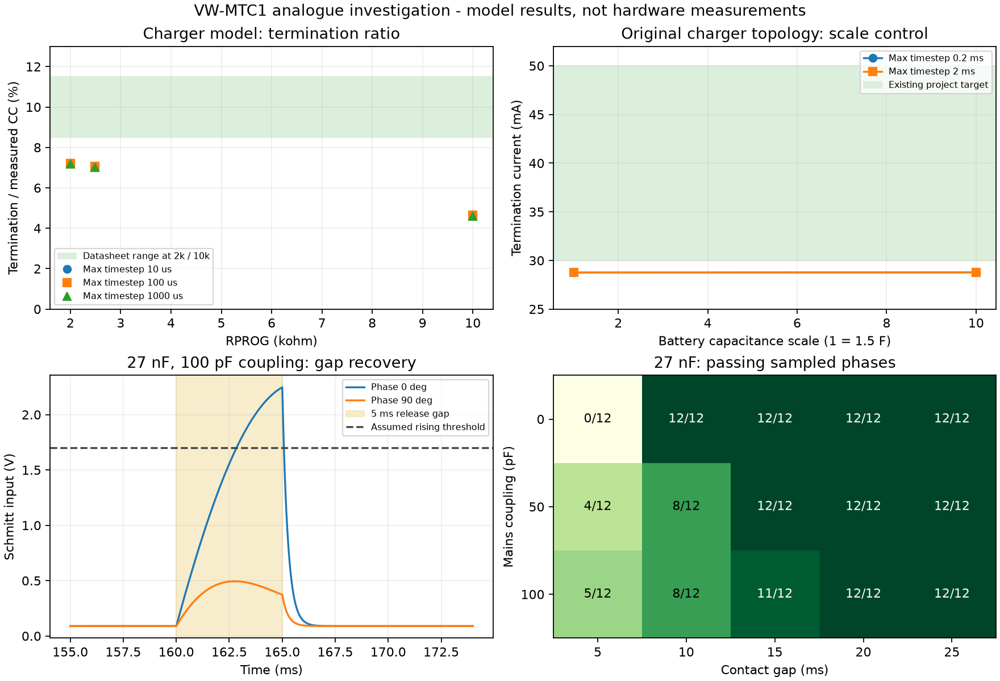

# VW-MTC1 verification - Rev01

This follow-up supersedes the incomplete analogue-run status in [Rev00](20261020-VW-MTC1-Verification-Rev00.md). Rev00 retains the original software bug register and build evidence. Scope: rerun the five timed-out cases, investigate charger termination and touch-gap failures, update PR #5 and merge after the checks pass.

## Long-case reruns

The timeout was increased from 180 to 1800 seconds per circuit, with at most two simulations running concurrently. The executed netlist bytes matched the existing source files. No component, solver or acceptance-limit changes were used to make these cases complete.

| Circuit | Completed in | Simulator/runner result |
| --- | ---: | --- |
| `sim01b_buckboost_loadstep.cir` | 150.89 s | Exit 0 |
| `sim01c_buckboost_ripple_eff.cir` | 170.55 s | Exit 0 |
| `sim03a_powerpath_unplug_proposed.cir` | 470.78 s | Exit 0 |
| `sim03b_powerpath_unplug_revised.cir` | 451.30 s | Exit 0 |
| `sim03d_powerpath_unplug_final.cir` | 351.84 s | Exit 0 |

The other 15 waveform sets came from the preceding verified run. All six analysis scripts and the summary generator then completed against the assembled 20-circuit dataset. The regenerated `results.json` exactly equals the archived values: **66 PASS, 93 INFO and 17 FAIL assessment rows**. Several FAIL rows belong to proposed/rejected variants; the charger and selected touch-gap failures remain visible.

Solver completion does not mean every assessment passed. The separate `sim03e_q1_gate_study` negative control also contains two failed stepped measurements, `t_on` and `t_full` for step 4, where R43 = 100 kohm. The runner previously missed LTspice's `4 failed` table-row format. A failing regression reproduced that review finding; the corrected runner returns exit 1 on the real gate-study case. This preserves the distinction between a completed simulation and successful measurements.

The fix is at `VW-MTC1/Simulation/tools/runlt.py:71`; the failing-then-passing regression is `tests/test_runlt.py:36`, `test_log_failures_are_not_success` with a stepped-table fixture.

Exact netlist hashes, durations and analysis receipts are in [the rerun receipt](../VW-MTC1/Simulation/Investigations/20261020-LTspice-Rerun-Receipt-Rev00.json).

## Charger termination

The ADI datasheet specifies termination at **8.5% to 11.5% of measured full-charge current** at its 2 kohm and 10 kohm RPROG test conditions. It describes a nominal 100 mV PROG threshold and approximately 1 ms filtering. See electrical characteristics, Note 6 and charge termination in the [LTC4054-4.2 datasheet](https://www.analog.com/media/en/technical-documentation/data-sheets/405442xf.pdf).

Thirteen diagnostic cases separated battery scaling, solver step size and the low-current model response:

| Control | Observed result |
| --- | --- |
| Original topology, 1.5 F / 15 F battery capacitance and 0.2 ms / 2 ms maximum steps | Termination remained **28.755 to 28.769 mA**, about **7.05%** of measured CC current |
| Slow externally driven battery, RPROG = 2 kohm, maximum steps 10 us / 100 us / 1 ms | Termination fraction **7.19% to 7.24%** |
| Same slow-ramp test, RPROG = 2.49 kohm | Termination fraction **7.01% to 7.07%** |
| Same slow-ramp test, RPROG = 10 kohm | Termination fraction **4.60% to 4.67%** |
| PROG just before cutoff | Approximately **79.4 to 80.1 mV** across ramp cases |
| IC BAT current versus cell current | Separately measured with a zero-volt sense source, excluding the output capacitor as an explanation |

The diagnostic bench applies a VCC startup ramp and checks that CHRG indicates charging during the CC reference window. Its final battery-voltage ramp is slow relative to the termination filter. The installed ADI symbol confirms the netlist's pin order: CHRG, GND, BAT, VCC, PROG. The model-file SHA-256 is retained in the results.

**Conclusion:** the supplied macro-model does not reproduce the datasheet's low-current termination behaviour in these controlled cases. The original 28.8 mA failure is not explained by coarse timestep, the small battery capacitor or measuring cell current instead of IC output current. This is evidence about the macro-model, not proof that physical LTC4054 parts violate their specification.

The board's 2.49 kohm programming resistor and the original 30 to 50 mA project check remain unchanged. Physical termination measurements or clarification of the vendor model are still needed. Changing RPROG to force this model's termination value would also change its full-charge current and is not a justified board fix.

## Touch-gap investigation

The actual BOM specifies **TI SN74LVC3G17DCUR**, rather than a single-gate buffer. The existing simulation uses an ideal Schmitt device with assumed thresholds of 1.7 V and 1.0 V. TI lists threshold ranges at 3.0 V; these are not a complete characterised 3.3 V corner model. See page 5 of the [SN74LVC3G17 datasheet](https://www.ti.com/lit/ds/symlink/sn74lvc3g17.pdf).

For the existing 10 kohm series resistor, 360 kohm pull-up and 27 nF capacitor, the no-interference approximation gives:

- Closed-contact input: 0.0892 V, including the 1 ohm switch model.
- Release time constant: 9.72 ms.
- Recovery to the assumed 1.7 V rising threshold: **6.77 ms**.
- Input after a 5 ms release gap: **1.38 V**, still below that threshold.

That independently explains why even the no-interference simulation cannot reliably separate a 5 ms pair. The mains coupling can either accelerate or oppose recovery, depending on phase.

The extended sweep used 12 mains phases, five gap widths, three coupling values and two capacitor values: **360 cases**. A pass requires one falling edge for each known contact, a high state in the gap, no extra pair-window pulses and no idle false pulses. Two chatter pulses during the first contact do not count as two contacts.

| Coupling, CF = 27 nF | 5 ms | 10 ms | 15 ms | 20 ms | 25 ms |
| --- | ---: | ---: | ---: | ---: | ---: |
| No interference | 0/12 | 12/12 | 12/12 | 12/12 | 12/12 |
| 50 pF | 4/12 | 8/12 | 12/12 | 12/12 | 12/12 |
| 100 pF | 5/12 | 8/12 | 11/12 | 12/12 | 12/12 |

Reducing CF to 15 nF resolves the 5 ms no-interference control, but at 100 pF coupling it resolves only 6 of 12 sampled phases at 5 ms. Release chatter and phase-dependent failures remain even at wider gaps. This is not a validated component substitution.

A further **180 sensitivity cases** compared the original assumed threshold pair with two pairs within TI's published 3.0 V bounds, using a 3.0 V supply for those cases. Neither additional pair passed every sampled phase at 20 or 25 ms. These are sensitivity examples, not an exhaustive or correlated process/voltage/temperature qualification.

**Conclusion:** the 5 ms requirement remains unmet by the selected passive front end. The 20 ms success in the nominal table is not a hardware guarantee. Firmware cannot reconstruct a missing second contact onset from an already merged binary pulse. A faster-release front end, reduced interference or a revised resolution requirement needs a separate design and bench-validation step.



## Reproduction and verification

The four diagnostic netlists, [machine-readable results](../VW-MTC1/Simulation/Investigations/20261020-Analogue-Investigation-Results-Rev00.json) and plot are under `VW-MTC1/Simulation/Investigations/`. The vendor's encrypted model is not redistributed.

With the documented Python environment and LTspice installed:

```powershell
.\.venv\Scripts\python.exe scripts/investigate_analogue.py --output build\analogue-investigation --timeout 600
.\.venv\Scripts\python.exe -m pytest -q
```

To reanalyse retained diagnostic waveforms without rerunning the simulator:

```powershell
.\.venv\Scripts\python.exe scripts/investigate_analogue.py --output build\analogue-investigation --analyse-only
```

Reanalysis rejects failed, missing or changed input receipts. Step order comes from the actual log, and the analysis rejects a mismatch between expected steps, log records and waveform slices.

Local verification: **95 Python tests pass**, including 14 new diagnostic tests and the stepped-measurement regression; the wheel and source archive build successfully. The actual four diagnostic netlists completed all **553 parameter cases**. The earlier 18 Android JVM tests are unchanged and remain part of PR/main CI. CI must be checked against the updated PR head before merge and against the merged base afterwards.

The original board, fabrication exports, archived plots/results and their limits were preserved. Hardware measurements, Android device instrumentation, board firmware/transport, existing CAD/lint warnings and the unresolved analogue acceptance items remain outside this software merge's acceptance.
