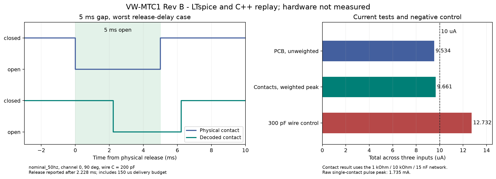

# VW-MTC1 touch redesign, Rev01

Rev B replaces the Rev A Schmitt inputs with synchronous resistance measurement.
The final LTspice timing suites passed **103,680 channel replays across 11,520
analogue cases**, with no missing, merged or extra contacts in the tested
envelope. The longest release delay was **2.228 ms** and the longest second-touch
delay was **2.161 ms**. Both 2 ms and 20 ms contacts were separated by 5 ms gaps.

These are model results. The board has not been built, flashed or measured.
This record supersedes the [Rev00 candidate](20261020-Touch-Redesign-Rev00.md).
The maintained KiCad files and Rev02 BOM now describe Rev B.



## Current requirement and measurement

The requirement is **10 µA total board-generated current across all three maze
inputs, including transients**. Following the decision to select the measurement
method, this design uses both of these acceptance checks:

1. **Unweighted current leaving the PCB:** no more than 10 µA in total, including
   discharge of populated board capacitors. The measured model peak is
   **9.534 µA**. All board capacitors and protection devices are behind the
   three limiting resistors.
2. **Frequency-weighted peak current at the contacts:** include charge stored
   in the external wires and measure through the network below. The worst
   three-input bound is **9.661 µA**, including contact bounce and instrument
   component tolerances. This is a peak test, not a time average.

The contact network is a 1 kΩ load from the body node to ground, in parallel
with a branch containing 10 kΩ followed by 15 nF to ground. Measure across
15 nF and divide by nominal 1 kΩ. Its nominal time constant is 165 µs,
approximately 965 Hz. This topology is shown in the
[Rigel 288+ manual, Appendix E](https://www.seaward.com/us/support/download/834).
The simulation sweeps both resistors and the capacitor through ±5%.

**This is not a 10 µA limit on unlimited-bandwidth raw contact current.**
The normal-envelope raw single-contact peak in this model is **1.735 mA**;
three times the single-channel peak gives a **5.205 mA** bound for independent
contacts. These brief pulses discharge external wire capacitance. They are
included in the frequency-weighted result, and are not hidden by averaging.
Using this measurement network does not establish compliance with a medical
standard.

The external wire/parasitic budget is **200 pF per input**, plus up to **110 pF
of mains coupling**. Measure the actual assembled harness before accepting it.
A 300 pF wire/parasitic negative control exceeds the weighted ceiling:
**12.732 µA**. Do not extend the harness or add capacitance on the exposed side
without repeating both the timing and current tests.

The limit concerns current generated by the board. The separate 253 V RMS
interference source used to test detection can supply additional current;
that interference test is not a leakage-current or human-use safety test.

## Circuit and firmware

| Item | Rev B implementation |
| --- | --- |
| R51, R53, R55 | 1.15 MΩ, 1%; simulation allows ±1.5% including drift margin |
| Excitation | GPIO41, hardware 1 kHz, 50% duty; R70 = 220 Ω and R71 = 100 Ω attenuator |
| Four bridges | 100 kΩ excitation, 187 kΩ upper bias, 200 kΩ lower bias; 0.05%, 10 ppm/°C parts |
| Sense capacitance | C34-C36 and C40 = 270 pF C0G; model total 260 to 300 pF |
| U10 | TPD4E05U06 protection on the protected sense nodes |
| U11 | OPA4323IPWR quad unity-gain buffer |
| U13 | ADS8344NB/1K, 16-bit ADC; CH0 wire, CH1 start, CH2 finish, CH3 unloaded reference |
| U14 | REF3325AIDBZR, 2.5 V ADC reference; pin 1 IN, pin 2 OUT, pin 3 GND |
| Quiet supply | R74 = 10 Ω; C41-C43 on +3V3_TOUCH; C46 at U14 input; C44 at the reference output |
| Shared SPI | MOSI11, SCLK12, MISO13; touch CS42, BUSY21; Hall CS10 retained |

The passive current bound is
`3 × 3.6 V / (1.15 MΩ × 0.985) = 9.5343 µA`.
The low resistance excitation divider prevents a contact from moving the
common excitation enough to create false events on another input. Its internal
current draw is separate from current delivered to the contacts.

The acquisition application sends a continuous 104-clock SPI burst at 2 MHz.
The thirteenth byte is needed to receive the final channel's LSB. Hardware
capture records the carrier, chip select and final SCLK edge. The first sample
must be 445 to 455 µs into the half-cycle; the other three acquisitions follow
at 12 µs intervals. A 150 µs delivery ceiling includes conversion and processing.

The decoder rejects DC and mains interference using actual acquisition times.
It uses 3.00% onset and 2.95% release thresholds, a 2 ms post-onset hold and a
4 ms post-release hold. Those holds were verified against the 5 ms gaps.
Clipping, bad framing, missing samples, wrong phase or a stopped reference
invalidate acquisition and require a new warm-up. An invalid frame never
manufactures a release. A held contact after startup or recovery is an initial
state, not a new onset event.

Short pulses can be reported after the physical contact has ended. The maximum
2 ms pulse onset delay was 2.658 ms. The output is therefore suitable for the
tested event-counting requirement; it is not a claim of sub-millisecond contact
timing accuracy.

The firmware owns MCPWM group 0 and reserves SPI during acquisition. It is a
standalone touch demonstrator, with diagnostic counters on USB Serial/JTAG.
Hall sampling, BLE, Android transport, storage and actuator control are not
implemented in this application. **Do not flash it onto an unmodified Rev A
board. GPIO41 changes from an input to an output.**

## Verification and model limits

| Check | Result |
| --- | --- |
| Simultaneous contacts | 9,984 LTspice cases, 89,856 channel replays, zero failures |
| Single-electrode interaction | 1,536 cases, 13,824 channel replays; idle channels remain open |
| Supply and interference | 3.15/3.3/3.6 V; 50/60 Hz, additional 48/62 Hz corners; up to 253 V RMS via 110 pF |
| Timing variation | 16 onset offsets in the main suite; ±5 µs acquisition jitter and ±100 ns timestamp uncertainty |
| Contact resistance | Direct contact and 100 kΩ contact; both limiting-resistor endpoints |
| ADC error | −12, 0 and +12 code cases, with opposite signs on signal and reference |
| Buffer/ADC acquisition | 20 stress cases; maximum settling error 4.516 µV, below half an LSB at 2.475 V |
| Board capacitor discharge | 9.534 µA total; original 10 kΩ path negative control reaches 1,090.8 µA |
| Contact-current network | 48 cases plus 144 bounce cases; worst three-input bound 9.661 µA |
| Excess cable capacitance | Negative control detected at 12.732 µA |
| Software | Host decoder/acquisition regressions, Python tests, Python package/generation checks and ESP32 firmware build |

The OPA4323 model is an explicitly bounded surrogate, not a manufacturer
macro-model. The bridge sweep uses resistor ratio errors of ±0.1%, ±1.5 mV
buffer offset, ±0.01% buffer gain error and a conservative output swing limit.
The separate acquisition model stresses bandwidth, slew rate and ADC sample
capacitance. The intended initial qualification range is 0 to 40 °C.

The main suite uses a constant 2.525 V reference, the high end of a ±1% reference
envelope, for pessimistic code-error sensitivity. ADC headroom is also checked
at 2.475 V. A separate TI REF3325 model run covers 0/40 °C, both supply endpoints,
startup, a 100 µA DC load step and illustrative 40 pC charge pulses. It stays
between 2.49772 V and 2.50030 V after startup, with 39.34 µV peak-to-peak ripple
in that pulse test. **That illustrative charge load is not a verified
worst-case ADS8344 reference-charge model.** Actual reference droop, conversion
noise and total error must be measured against the ±12-code replay envelope.

Static supply corners do not qualify converter ripple, RF activity, arbitrary
interference or every possible contact-bounce waveform. PCB parasitic extraction,
component ageing and ESD stress are not included. The current proof applies to
normal operation within the stated rail and capacitance bounds, not every
single-fault condition.

Sources used for pin maps and component bounds:
[ADS8344](https://www.ti.com/lit/ds/symlink/ads8344.pdf),
[OPA4323](https://www.ti.com/lit/ds/symlink/opa4323.pdf),
[REF33, Rev I](https://www.ti.com/lit/gpn/REF33),
[Susumu RG series](https://www.susumu.co.jp/common/pdf/n_catalog_partition01_en.pdf).

## Reproducing the checks

Follow the repository Python setup first. With LTspice installed:

```powershell
.\.venv\Scripts\python.exe scripts/verify_touch.py --output build/touch --workers 3
.\.venv\Scripts\python.exe scripts/verify_touch.py --interaction --output build/touch-interaction --workers 2
```

Use `--reuse` only for an existing run directory. It verifies circuit, log and
waveform hashes before replay. `--case` is a partial diagnostic run and is marked
as such. The verifier rejects source changes made during a run.

Firmware build, with project-local tools:

```powershell
python -m venv .tools/firmware-env
.\.tools\firmware-env\Scripts\python.exe -m pip install platformio==6.2.0
$env:PLATFORMIO_CORE_DIR = Join-Path (Get-Location) ".tools/platformio"
.\.tools\firmware-env\Scripts\python.exe -m platformio run -d VW-MTC1/Firmware
```

The platform is pinned to `espressif32@8.0.0`, using ESP-IDF 6.1. The CMake
component list is restricted to the acquisition application and its dependencies
to avoid the Windows command-length failure in an all-components build.

The [machine-readable result](../VW-MTC1/Simulation/Touch-Redesign/20261021-Touch-Verification-Rev01.json)
and [evidence archive](../VW-MTC1/Simulation/Touch-Redesign/20261021-Touch-Evidence-Rev01.zip)
contain every case result, generated circuit, simulator log and source/output
hash. Raw waveforms remain regenerable. The TI reference model is linked and
hashed rather than redistributed.

## Reproduced defects

Line references below refer to the preserved Rev A commit `ce62852988d1`.

| Defect | Source and failing check | Fix |
| --- | --- | --- |
| A 5 ms release gap can disappear | `Hardware/KiCad/MazeIO.kicad_sch:10621` and `:10706`, 360 kΩ / 27 nF. The legacy gap circuit with `CASE=5, PH=90, CC=100p` produces one pulse for two contacts, with `gap_and_idle_pass=false`. The rerun is retained under `legacy/` in the evidence archive. | Replace the RC/Schmitt path with the synchronous bridges and timestamp-aware decoder. |
| Per-input DC arithmetic does not bound total transient current | `Hardware/KiCad/MazeIO.kicad_sch:10536`, 10 kΩ series resistor. The three-capacitor negative control peaks at 1,090.8 µA; `test_original_ten_kilohm_resistor_fails_current_boundary` also rejects that resistance in the new topology. | Put 1.15 MΩ in every exposed signal path and place protection/capacitance behind it; test the total and the external stored charge. |

The automated topology test also fails if a capacitor or protection connection
bypasses a limiting resistor. Acquisition tests reject a truncated 12-byte
transfer, invalid padding, bad timing, counter rollover errors and clipped data.

## Remaining acceptance work

Measure the finished board and harness: total current with the declared network,
raw contact pulses, actual cable capacitance, GPIO drive/rail limits, reference
transients, input noise and capture timing under the intended system workload.
Repeat the 2 ms contacts and 5 ms gaps on each channel and with simultaneous
contacts. Check ESD protection, resistor pulse stress and the effects of Wi-Fi,
USB power and Hall acquisition.

Native ERC/DRC and schematic-to-PCB parity are recorded separately under
`Hardware/Reports/`. Remaining silkscreen, isolated-copper and hole warnings
need a fabrication review. The Rev00 Gerbers, pick-and-place and STEP files
describe Rev A and must not be combined with the Rev02 BOM.
This PR is for review of the prototype redesign, not fabrication or clinical
release.

## CAD review record

The final native KiCad checks report **0 ERC errors / 1 warning**, and **0 DRC
errors / 0 unconnected items / 0 schematic mismatches / 206 warnings**. The
remaining DRC warnings comprise 124 silkscreen-over-copper, 62 silkscreen overlap,
8 silkscreen edge-clearance, 6 isolated-copper, 3 dangling-track, 2 co-located-hole
and 1 hole-clearance findings. No electrical rule was disabled to obtain the
result. Existing fabrication minima were retained.

Schematic, full PCB, cross-analysis and EMC scripts were run in addition to
native checks. Their output is advisory and was checked against native files:

- The cross-analyser's claimed +3V3_TOUCH plane split is a net-mapping false
  positive. Native KiCad identifies the planes as GND and +3V3; there is no
  +3V3_TOUCH plane.
- Generic decoupling warnings for USB ESD arrays and a differential-pair warning
  for the motor output are not evidence of those specific circuit faults.
- USB edge proximity and USB/SPI return-path transition warnings remain for
  layout/EMC qualification. In particular, the SPI return path must be checked
  on the assembled board alongside touch noise.

The KiCad MCP wrapper could not locate this machine's KiCad installation.
Native KiCad 10.0.6 CLI/Python at its installed path supplied the recorded ERC,
DRC, connectivity, placement and export checks. Routing used FreeRouter 2.0.1;
empty session exports were rejected before import.

Touch IC pin maps were checked against manufacturer documentation. The original
power sheet was retained. A complete thermal/lifecycle audit, review of a new
Gerber set, physical EMC testing and medical compliance assessment were not
performed as part of this touch redesign.
